# M12 — Reliable recall

Date: 2026-10-23. Status: implemented in the working tree; live quality acceptance remains open. Baseline: `1a14f2d`, oxibrain 0.19.0, architecture 2.23, brain schema 14, document cache schema 3.

This contract was designed and then implemented at the owner request. It preserves P1–P11 and the sixteen-tool cap. [ADR-019](../adr/ADR-019-read-scope-and-evidence-recall.md) records the architectural choices; [ROADMAP §11](../ROADMAP.md#m12-reliable-recall) sequences the work. The [implementation report](../research/2026-10-23-reliable-recall-implementation.md) records what was tested; no general reader-quality gain is claimed.

## 1. Goal and scope

A consumer can retrieve a relevant note, an older session decision, or part of a long execution record within a declared context budget, with usable provenance and honest loss accounting. A historical query must not acquire current claims through a snippet or summary after its candidates were filtered.

The [research report](../research/2026-10-23-recall-quality-and-evidence.md) documents five public-operation failures that define the first acceptance set: document search/recall divergence, the newest-five session cutoff, the 200-character session prefix, rejection of a whole long trace, and ignored `known_at`.

M12 delivers one read-scope contract, document-aware public recall, queryable source slices including sessions, a pure evidence packer, and provenance/budget evaluation. Model-based reranking, learned memory management, new experience predicates, and durable outcome feedback remain follow-up experiments. Existing semantic adapters can contribute candidates when configured; M12 does not require them for correctness or download a model during an ordinary read.

## 2. Public contract and compatibility

### 2.1 Operations

Keep `search` and `recall` as separate operations. Both use the same scope validation and visibility implementation. Search renders entity/document hits; recall composes context. No discriminator operation or additional MCP tool is introduced.

Existing recall input fields remain: `space`, `query`, `token_budget` (default 3000), and optional `session_id`. Add only:

| Field | Default | Meaning |
|---|---|---|
| `planes` | `["memory", "documents"]` | Requested planes, with the same empty-set behavior as search. |
| `as_of` | absent | Valid-time instant for historical memory, Unix milliseconds UTC. |
| `known_at` | absent | Transaction-time cutoff for historical memory, Unix milliseconds UTC. |
| `require_exact_tokens` | `false` | Require the configured exact tokenizer; fail if it is unavailable. |
| `explain` | `false` | Include a bounded per-unit decision trace. Counts and selected source references are always present. |

Search retains its existing fields. Its advertised `known_at` becomes executable. `min_confidence` is explicitly a memory belief-confidence threshold; it is never a document reliability score. A documents-only request with a positive memory-only threshold is invalid. Recall initially uses the configured belief floor rather than adding another public confidence knob.

The op registry remains the sole schema authority. CLI, MCP, generated skills, and the client SDK derive their payload contracts from it. Timestamps are validated and converted to `Timestamp` once at the boundary. `known_at` after the captured request time is invalid; future valid time is permitted. Unsupported fields or filter combinations produce typed input errors.

```json
{
  "space": "personal",
  "query": "Umbra rollback decision",
  "token_budget": 2000,
  "require_exact_tokens": true
}
```

Historical memory is explicit:

```json
{
  "space": "personal",
  "query": "employment decision",
  "planes": ["memory"],
  "known_at": 0,
  "token_budget": 2000
}
```

**Document time is a capability boundary.** `documents.db` contains current observations and optional Git history, not an acquisition-time ledger. M12 does not reinterpret file modification time or a Git commit date as transaction time. Any request selecting Documents together with explicit `as_of` or `known_at` returns `unsupported_temporal_scope`, identifying the plane and offending fields. The caller can request historical memory with `planes=["memory"]` and make a separate current-document request. No current document is quietly included in a historical response. This intentionally tightens formerly accepted combinations that did not enforce their apparent scope.

### 2.2 Rust facade

Introduce canonical request types rather than adding required fields to the public legacy `Query` struct:

```rust
// Design signatures. The implementation supplies derives/builders and typed IDs.
pub struct ReadScope {
    pub space: SpaceId,
    pub as_of: Option<Timestamp>,
    pub known_at: Option<Timestamp>,
    pub min_confidence: f32,
}

pub struct SearchRequest {
    pub text: String,
    pub scope: ReadScope,
    pub planes: BTreeSet<SearchPlane>,
    pub mode: QueryMode,
    pub limit: usize,
}

pub struct RecallRequest {
    pub text: String,
    pub scope: ReadScope,
    pub planes: BTreeSet<SearchPlane>,
    pub budget: ContextBudget,
    pub session_id: Option<String>,
    pub require_exact_tokens: bool,
    pub explain: bool,
}

pub struct ReadResponse<T> {
    pub data: T,
    pub meta: ReadMeta,
}

pub struct RecallData {
    // Serialized flat to retain layers/total_tokens/budget/truncated.
    pub context: ContextResult,
    pub evidence: Vec<EvidenceCitation>,
}
pub type RecallResponse = ReadResponse<RecallData>;

pub async fn search_with_scope(&self, req: SearchRequest)
    -> Result<ReadResponse<SearchResponse>, BrainError>;
pub async fn recall_with_request(&self, req: RecallRequest)
    -> Result<RecallResponse, BrainError>;
```

`ReadMeta` is facade-owned composition of core decision accounting, source freshness/snapshot observations and capability descriptors. The transports serialize it rather than recomputing losses from returned hit counts. The existing inner `{data, meta}` and outer CLI envelope nesting remain unchanged.

`Brain::search(Query)` delegates with its representable defaults and projects the legacy `SearchResponse` from `.data`. Existing `Brain::recall(...)` delegates to both-plane recall and returns the legacy `ContextResult` projection. Existing `assemble_context*` methods delegate with Memory only and retain their composition hints. Deprecation is documented; these wrappers do not keep independent query implementations. MCP and CLI use the canonical requests directly. The SDK gains matching methods and can project the richer response for existing callers.

Avoiding new required legacy struct fields preserves its existing struct literals. New public error-enum variants can still require downstream exhaustive-match updates; the implementation release must document that Rust compatibility change and version it according to the workspace's pre-1.0 policy. JSON input additions alone are not a promise of complete Rust source compatibility.

## 3. Responsibilities and execution

```mermaid
flowchart LR
    API[CLI / MCP / Rust] --> Scope[Validate scope and capabilities]
    Scope --> Facade[Facade captures request time]
    Facade --> Fetch[Store and connectors fetch observations]
    Fetch --> Decide[Core reconstructs visible claims and ranks]
    Decide --> Units[Core builds source evidence units]
    Units --> Pack[Pure pack and canonical render]
    Pack --> Verify[Facade validates selected sources]
    Verify --> Response[Context, provenance, freshness and losses]
```



| Component | Owns |
|---|---|
| `oxibrain-ops` / transports | Schema, input parsing, authorization, envelope serialization. |
| `core::read_scope` | Pure request validation against capability descriptions and resolved request time. |
| `core::evidence` | Unit identity, source coordinates, visibility decisions, excerpt variants, and decision accounting. |
| `core::evidence_pack` | Deterministic selection, source pairing, exact budget checks and rendering. |
| `store::read_evidence` | Batched assertion/mention/source/chunk fetches and mechanical lexical queries; no folding, relevance policy, or packing decisions. |
| `oxibrain::recall` | Sequences fetch → pure decisions → optional adapter calls → materialization → packing → source validation. |
| Connectors / document cache | Existing PDC classification, decoding, generation checks, revision materialization and diagnostics. |

Capture `request_time = ClockPort::now()` once. Resolve valid time and transaction time from the explicit fields or this value. Fetch assertions and registry definitions, then reconstruct truth with core's existing fold. The store never selects a belief by a SQL heuristic. Historical reconstruction and target-fact preparation move out of the legacy mixed query executor as it is replaced.

Embedding and optional future reranking execute at the facade boundary after database handles/transactions have been dropped. Their output is input data for a pure decision, with strict ID-set validation. A model cannot introduce a candidate, change provenance, override a filter, or write a truth row through this read path.

The two databases have separate snapshot receipts. A response identifies the memory ledger frontier and each document root generation; it never claims a transaction spanning both stores.

Document reconciliation on a read is bounded by configured file/read-byte limits. A complete root scan may publish its existing CAS apply plan. A scan that reaches its limit publishes no partial root diff, especially no inferred deletions, and serves only revision-verified cached candidates with `reconcile_budget_exhausted` and partial freshness. Other roots can finish independently. An empty/unbuilt cache is distinguished from no matches; `admin index --documents` remains the explicit complete reconciliation path. This keeps a per-turn call from turning into an unbounded first-time vault import.

## 4. Visibility applies before every rendering

### 4.1 Historical truth

For each subject/predicate group relevant to a candidate, fetch the assertion inputs needed to fold at `known_at`, including competing functional values, denials, and retractions. Filtering today's cached belief using `MAX(recorded_at)` is insufficient: a later replacement must not erase the older value from a historical read.

A fold input group must be complete. When a configured truth-input limit is reached, discard that entire group with `truth_group_incomplete`; never compute a belief from a truncated group that might omit its denial or replacement. The result is partial execution. Fetch completeness is an observation supplied to core, not a store-side truth decision.

Core produces one `VisibleMemory` value consumed by ranking, graph edges, profile, entity display names, snippets, beliefs and supporting excerpts. A renderer cannot query current beliefs independently. Historical merge redirects and display names come from declarations/mentions visible at the cutoff; an unavailable historical display name falls back to the stable ID, never a future alias.

| Evidence | Eligibility |
|---|---|
| Structured belief | Fold assertions visible at K; select validity at T; apply registry semantics, effective trust and confidence policy. |
| Supporting source of a selected belief | Source received by K, currently accessible/non-redacted; cite the assertion/mention that made it support this belief. A later observation may support an earlier valid-time claim when it is known by K. |
| Independent Primary/session excerpt | Received by K; with explicit `as_of=T`, observed at or before T. Render as a dated source observation, not a folded claim about state at T. |
| Entity/snippet/neighborhood | Derive from the same visible claims and identities. Empty current-fact enrichment is preferable to a future claim. |
| Derived summary/runbook | Current reads require all support references and uncertainty. An explicit historical cutoff requires a matching, verifiable summary scope; legacy summaries without it are omitted with `summary_scope_unavailable`. M12 does not generate a summary during a read. |
| Document | Current-only under §2.1; preserve its revision, decoder identity, reader diagnostics and unverified source status. |

Historical support selection never restores redacted bytes or revoked access. Authorization and redaction checks remain current. Trust provenance stays server-evaluated ledger state; caller text cannot promote itself. Identical content in two independent episode occurrences remains two sources.

The raw-episode rules constrain observation visibility; they do not claim that every sentence in a historical source was true at T. Folded statements and quoted source observations remain distinct evidence roles in both the rendered context and structured metadata.

### 4.2 Read races

Add an operational `exposure_epoch` in `meta`, incremented in the same write transaction as redaction or other access-invalidating changes. It is a CAS token, carries no semantic truth, and is never read by the fold. Reprojection preserves/increments it; restore uses a new isolated store as today.

After inference/materialization, revalidate the selected episode references against current redaction/access state. If the exposure epoch changed, discard the materialized result and retry from a fresh observation once. A second race returns typed `Busy`; an old in-memory copy of redacted text must not escape. This validates a read linearization point; it does not promise an atomic read across future writes.

Documents keep the existing one-rescan CAS policy. A revision/digest mismatch discards that unit and retries materialization once; continued change is a visible stale-source omission. Never return the bytes of revision B with the citation of revision A. Normal new ledger writes need not restart a query: its semantic cutoff/frontier was captured and is reported.

## 5. Source evidence units

A unit is a ranking/response object, never a new ledger event or a canonical document format.

```rust
pub struct EvidenceUnit {
    pub id: EvidenceUnitId,
    pub plane: SearchPlane,
    pub role: EvidenceRole, // belief, source observation, or derived summary
    pub source: EvidenceSource,
    pub ranges: Vec<SourceRange>,
    pub variants: Vec<EvidenceVariant>,
    pub retrieval: RetrievalEvidence,
    pub support: Vec<EvidenceReference>,
    pub uncertainty: Option<Uncertainty>,
}
```

- Episode sources carry space, episode ID, content hash, source provenance, occurrence time and effective trust. Byte ranges address immutable `episodes.content`.
- Document sources carry root, locator, revision, decoder version, decoded-view digest and the canonical PDC UUID when present. Ranges explicitly address the decoded UTF-8 view. HTML/Djot decoded offsets are never advertised as raw-file offsets. The existing `doc://` URI remains a location/revision reference, while a PDC UUID remains document identity. Legacy inputs may have no UUID.
- Unit IDs hash a versioned, length-delimited encoding of source occurrence/identity, revision/view, role, byte ranges and unit-policy version. IDs never depend on a ranking score, model float, wall clock, or hash-map order.
- A summary variant includes uncertainty and references to every supporting source. Support references do not imply that every full source body is included. Missing/redacted required support invalidates the summary bundle. Supporting excerpts may be selected separately and share their references without duplicating text.
- A belief variant includes its subject, object, predicate, validity and statement/support references. Negation, contradiction state, provenance and applicability text cannot be shortened away to make a structured belief fit.

A unit retains channel ranks and the reason it was considered. Exact deduplication is within the same source occurrence and coordinates; equal bytes from independent events never collapse. Overlapping ranges from one source can share rendered text, with both unit references preserved. Evaluation computes span coverage by range union, so overlap cannot inflate coverage.

## 6. Indexing and relevant-session retrieval

### 6.1 Coverage before scoring

Replace the current splitter's hard-cut tail behavior with a versioned, pure splitter whose windows cover the entire eligible input. It must make progress for a long separator-free line and cut only at UTF-8 boundaries. Preserve paragraph/tool-step boundaries where possible; oversize blocks split into overlapping windows rather than dropping their tail. Generic byte/Unicode boundaries and the documented trace structure are sufficient; no language detector or word list is added.

Initial configurable limits, to be measured rather than described as calibrated:

| Policy | Initial value |
|---|---|
| Index window maximum / overlap | 2,048 / 256 UTF-8 bytes; overlap reduced at a boundary if needed for progress. |
| Fetch depth per lexical channel | 64 units; word and n-gram channels both execute. |
| Candidate cap after source identity dedup | 256 units per plane. |
| Query-relevant session fetch | Shared word/n-gram source channels; no recency cutoff before the memory cap. |
| Session recency fallback | At most two sessions, lower priority than query matches. |
| Final source materialization | 8 MiB per request; remaining work gets an explicit cap reason. |
| Truth-fold input | 8 MiB per request; incomplete groups are excluded whole. |
| Read-time document reconciliation | 4,096 observed directory/file entries / 8 MiB source reads per request; unfinished roots retain their previous complete cache generation. |
| Mandatory evidence metadata / optional explanation | 64 KiB / 16 KiB, separately capped. |
| Graph expansion | One hop, at most 64 nodes, under the same visibility rules. |

Configuration is versioned and exposed through capabilities; these are implementation bounds, not new semantic thresholds. More than 64 matches means a bounded search, not proof of corpus-wide completeness.

### 6.2 Persistent ranking state

Plan brain schema **15** from the inspected baseline. The migration adds `memory_chunk_fts_word` and `memory_chunk_fts_ngram`, keyed by space, episode and existing chunk ID, plus ranking-build metadata in `meta`. Keep existing episode/entity FTS target strings intact so legacy `SearchTarget` decoding does not encounter a new unsupported kind. Reuse the existing `chunks` source offsets; Primary source retrieval indexes sessions and traces without requiring extraction. Exclude Declaration bodies and legacy document/document_revision episodes from this raw-source index. Derived summaries remain bundles on their own retrieval path.

The new tables are derived ranking state. A schema-14 up-test asserts unchanged ledger and truth snapshots. No source document is rewritten and no extraction is requested by migration. If another migration consumes 15 before implementation, allocate the next version and update this spec and its fixture together.

New Primary writes update their chunk/lexical rows as a mechanical ingest projection, including `session_record`. Compute source windows before acquiring the writer, then commit the episode and its raw lexical projection in the same short transaction; failure cannot acknowledge a new episode while leaving an untracked indexing hole. No model runs in that transaction.

Existing episodes are backfilled by proposed `admin index --memory`; existing `admin index` retains documents as its default, and `--documents --memory` requests both. Backfill captures a target ledger sequence and processes canonical-sequence batches. Its cursor advances in the same transaction as each completed batch's chunk/FTS rows; rollback leaves the prior cursor. New writes beyond the captured target use the atomic path above. Persist the target, next sequence and policy version, so retries cannot skip a crash-created hole. A policy mismatch restarts the affected ranking build, not extraction. Reprojection rebuilds these tables and marks coverage complete.

An incomplete backfill is visible in `meta.index_coverage` with pending counts/frontier. Bounded compatibility fetching can serve already available observations, but it must not call this complete old-session retrieval. Reads never perform an unbounded backlog drain. Read-only stores use available indexes and report missing coverage. Redaction explicitly removes corresponding virtual-FTS rows as well as chunks; backup projection omission/restore lists include the new tables.

Planes retain their own scores. Within Memory, session relevance is merged from word/n-gram unit ranks with source membership, not from a newest-five cutoff. Exclude the caller's session before selection. Keep a small, separately identified recency fallback for session continuity. No query-dependent decision writes a salience or outcome fact.

Document cache schema 3 is sufficient: its chunk offsets, root generation and decoder fingerprint already exist. Change the ranking/unit policy fingerprint so affected roots re-chunk when required; preserve the PDC corpus pin and all existing conformance diagnostics. Indexing never fetches external URLs, executes `.base` content, assigns IDs, or repairs a vault.

## 7. Pure packing and token accounting

### 7.1 Selection

`pack_evidence(input, policy, tokenizer)` consumes materialized, authorized units and returns selected units plus an exhaustive decision for the **considered** unit set. It performs no I/O or inference. Equal snapshots, policy, tokenizer and adapter outputs produce byte-identical context and trace.

1. Prepare complete render variants, including references, source role, dates, validity and uncertainty. Source observations can offer a full window and a smaller query-bearing window with neighboring context. They remain quotations, with any omitted range disclosed. Never claim a source excerpt is a complete procedure or promote it to a belief.
2. Apply the existing profile priority as a floor bounded by B and by complete lines that fit. Profile has no right to violate B; a too-small budget yields an explicit exclusion.
3. Give each requested plane with an eligible fitting query unit one opportunity before a plane can consume the remaining budget. Alternate Memory/Documents in fixed order, selecting by within-plane rank and stable ID. Raw BM25/dense scores from different planes are never compared.
4. Try a smaller complete variant when a unit is too large. If none fits, record `budget_excluded` and **continue to later candidates**. Bundle dependencies, including summary sources/uncertainty, fit or leave together.
5. After query-bearing units, spend at most `min(B/10, 200)` token units on the two-session recency fallback. Unused space is reclaimed by further query units. A recency-only observation is explicitly marked as such.
6. Render selected units into the existing layer kinds/order. Selection happens before rendering order, so a source layer near the end is not automatically starved by an earlier layer. Deduplicate repeated source text within its source/view while preserving references.

Mandatory source/reference metadata must fit its separate byte budget before selecting a unit. An unrepresentable bundle gets `metadata_budget_excluded`; its provenance is never silently clipped. Optional explanation is capped first and cannot displace mandatory selected-source references.

Stable tie-breaks are part of the policy. The packer is a bounded greedy procedure, not a claim of optimal set cover or knowledge sufficiency. Its quality is evaluated on held-out support sets.

### 7.2 Exactness

Define canonical context serialization `context_render/1` as the ordered `layers[].text` joined by exactly two LF characters, with no implicit heading supplied by the client. All source labels, citations and uncertainty text are already inside those layer texts. Count the complete candidate serialization on each tentative addition; summing per-line counts is not exact for a subword tokenizer. Caps bound this work; optimization may memoize only where equivalence is tested.

`total_tokens = TokenizerPort::count(canonical_context)` and must be ≤ B under the reported tokenizer. The JSON envelope and optional explanation metadata are outside this context budget and separately byte-capped; SDK docs make this boundary explicit. Do not duplicate all context as another `context_text` field. The SDK exposes the canonical renderer so consumers can inject exactly the counted text.

Tokenizer setup is independent of extraction: add `Brain::with_tokenizer` and a descriptor containing identity, artifact digest and `Exact | Estimate | Unknown`. A backward-compatible trait default is Unknown; `CharTokenizer` is Estimate. Reading a locally available tokenizer may load its artifact but may not start a model download or inference call. `require_exact_tokens=true` with Estimate/Unknown returns `tokenizer_unavailable`. Otherwise compatibility calls can use the fallback, with `meta.tokens.exact=false` and no hard claim about the consumer model's token count. Exactness is always relative to the reported tokenizer.

Keep `estimated_tokens` in each legacy layer for wire compatibility; describe it as that layer's independent count/estimate. It need not sum to the cross-layer exact total. A token budget too small for any complete unit returns empty context with a budget exclusion, distinct from an empty search.

## 8. Response and loss accounting

Preserve `data.layers`, `total_tokens`, `budget`, `truncated`, existing layer names and the established outer transport envelope. Add selected evidence references and metadata without repeating source text:

| Field | Contract |
|---|---|
| `data.evidence[]` | Unit ID, layer index and rendered-text ranges, source coordinates/revision, evidence role, trust provenance, support references. |
| `meta.tokens` | Spent, budget, tokenizer identity/digest, exactness, and `context_render/1`. |
| `meta.scope` | Requested and effective cutoffs, planes, request time and per-plane snapshot receipts. |
| `meta.freshness` | Existing document freshness diagnostics plus memory ranking-index coverage. Empty roots and failed roots stay distinct. |
| `meta.layers_kept` | Exactly `data.layers.len()`. |
| `meta.execution` | Complete or partial execution, adapter capabilities used/missing, cap hits and source races; never an answerability probability. |
| `meta.dropped` | Accurate aggregate counts by stage/reason, scoped to the considered unit set. |
| `meta.decisions` | Optional bounded ID-level trace when `explain=true`, with its own truncation/cursor-free summary. Counts remain complete. |

`data.truncated` means an eligible considered unit or a declared candidate range was omitted/shortened because of output/materialization/candidate limits. Ordinary temporal/trust exclusions remain counted filters rather than budget truncations. Index gaps, failed roots and source races separately make execution partial. A bounded successful search does not imply all relevant evidence was found.

Every normalized considered unit ends in exactly one terminal decision: selected (with variant/omitted-range details), filtered, duplicate source range, missing support, unavailable source, candidate/materialization cap, or budget exclusion. Channel multiplicity is recorded before dedup and is not counted as multiple source units. Counts cannot pretend to enumerate unseen/unindexed corpus content.

Typed errors are added to `BrainError` for unsupported temporal scope and unavailable exact tokenizer; transports map them to stable input/configuration codes with no retry. Busy remains retryable. Malformed reranker output, absent dense capability and optional adapter timeout yield a recorded lexical fallback; authorization, invalid scope and a required tokenizer failure never silently degrade. Raw-source snippets remain typed untrusted observations regardless of their ranking score.

An intentionally unconfigured optional adapter is a capability absence, not a failed operation. A configured adapter that fails makes execution partial/degraded. No configured document roots is distinct from a missing configured root: the former is an empty capability/configuration observation, the latter partial freshness. None of these states is reported as certainty that the underlying knowledge does not exist.

## 9. Evaluation and acceptance

### 9.1 Required behavioral tests

| Case | Required result |
|---|---|
| Indexed canonical PDC Markdown document | Public CLI and MCP recall contain its answer-bearing slice, canonical UUID and revision reference; source bytes unchanged. |
| Older relevant session behind ≥8 newer sessions | Relevant slice selected; caller's current session remains excluded. |
| Relevant evidence after summary character 540 | Slice includes evidence, not merely a prefix; omitted ranges are explicit. |
| 48,735-character trace and separator-free larger source | Relevant tail reachable under a real tokenizer; byte length separately recorded; splitter covers the tail and respects UTF-8. |
| Oversized first unit plus small second unit | Second fits; first has a terminal budget decision. |
| `known_at` before the declaration | No later claim or snippet, future alias or merge leaks into the response. |
| Later functional replacement/denial/retraction | Earlier valid belief is recovered at the earlier transaction cutoff. |
| `as_of` versus `known_at` | Independently varying axes changes the intended truth, including profile and edges. |
| Historical request with Documents | Typed unsupported-scope error; no current file is mixed in. |
| Summary with missing/redacted support or unknown historical scope | Summary omitted with its actual reason. |
| Unrelated word occurrences / same answer in wrong relation | Provenance scoring fails the answer; string presence is insufficient. |
| Non-ASCII UTF-8, punctuation, no spaces, combining characters | Full source-window coverage and budget properties; no script routing. |
| Missing tokenizer / missing embedder / MLX embedding restriction | Required exactness errors; optional channels visibly fall back. |
| Redaction during adapter work / document revision race | Fresh retry or typed/diagnosed failure; no stale bytes with valid-looking provenance. |
| Migration 14→15, interrupted backfill, repeat reproject | Ledger and truth unchanged; ranking membership/coverage reconstructed; no duplicates. |

Add property tests for unit conservation, progress/full byte coverage, valid UTF-8 ranges, deterministic IDs/order, budget soundness including separators/citations, summary pairing, filter totality, and idempotent index resume. The existing truth reprojection determinism test remains enabled and unchanged in its byte-identical contract. The ≤10pp writing-system parity rule remains in force.

### 9.2 Quality measurement

Keep the existing fast/canned suites, labeled as fixture replay and answer reachability. Add an in-house span-annotated held-out set, separate from prompt examples and tuning fixtures, with project/time/environment-separated cases. The initial design target is 200 questions, reported by category and writing-system property; it is a sampling plan, not evidence of adequate statistical power.

Report Full Support@B, recovered supporting-span fraction, correct-answer-with-correct-provenance, unsupported claims, appropriate abstention, local extraction precision/recall, p50/p95 latency, peak memory, index bytes, and write/read costs. Full Support requires every annotated necessary source span; the runtime never claims this metric without gold annotations. Freeze tokenizer, reader, prompt, embedder, source access and budget across paired retrieval arms; include gold-evidence and no-evidence reader controls. Keep the historical lexical-only graph ablation under its actual label, and separately run the documented lexical+dense control. Report paired uncertainty intervals, grouped by source trajectory rather than treating related questions as independent.

Implement the current `full` stub as an explicit live local/provider evaluation runner, with pinned artifacts and captured responses for subsequent offline replay. The reader is an evaluation client, not a new product answer-generation operation. Optional frontier providers require explicit evaluation configuration. Corpus/data reports remain generated repository artifacts outside the user-document plane. Public LongMemEval/LoCoMo harnesses remain deferred.

M12 acceptance requires all correctness cases and mandatory regression checks to pass, a real-tokenizer run on the held-out corpus, no regression beyond existing quality tolerances, and published costs/failures. A claim of quality gain requires the paired results; fixing the five synthetic failures alone establishes correctness of those cases. New dense/reranker policies stay opt-in until they improve measured evidence or supported-answer quality within the recorded cost envelope.

## 10. Delivery and rollback

| Batch | Reviewable result | Exit |
|---|---|---|
| A | Shared read scope; public document routing; time-aware snippets; correct metadata. | Public document/`known_at` tests and backwards-compatible default payload tests. |
| B | Versioned complete source windows, schema-15 chunk indexes, resumable session backfill. | Old-session/tail tests, migration/resume/redaction tests, truth snapshot unchanged. |
| C | Evidence packer and canonical token accounting, independent tokenizer binding. | Exact-token/property tests, oversized-first case, source pairing and visibility race checks. |
| D | Held-out evidence evaluation and functioning live-runner path. | Required checks, paired report, accurate costs and remaining limitations. |

The five public probe tests span A–C; intermediate batches must state which are still failing. No unfinished batch is called reliable recall complete.

No source-data conversion or bulk re-extraction is part of delivery. Ranking-policy rollback rebuilds the disposable chunk indexes from the same ledger and files. A binary that only understands schema 14 cannot reopen schema 15; binary rollback uses a verified pre-upgrade backup restored to a new directory, never an in-place schema downgrade. Follow existing backup/restore rules and preserve cached extraction evidence. Review implementation diffs against P1–P11, the standalone build, PDC conformance, migration-chain coverage and the sixteen-tool catalogue.


## 11. Implementation notes (0.20.0)

- Memory source, summary and claim channels are interleaved before alternating planes, so a long list of structured claims cannot starve procedure sources.
- Raw windows use their own `memory_source_chunks`, rather than replacing legacy contextual `chunks`. Word/n-gram source channels use inverse observed breadth to weight bounded query-term lists before RRF; this is not corpus IDF or a learned policy.
- `ReadPolicy` version 1 configures engineering bounds through a facade builder or `OXIBRAIN_READ_POLICY_JSON`; active limits appear in receipts and MCP experimental capabilities. Profile priority is capped at `min(B/4, profile_tokens)` (default 300), with no forced overflow; recency remains capped at `min(B/10, recency_tokens)` (default 200).
- Current summary support is checked before rendering. Explicit historical scope omits summaries without a verifiable matching scope. The optional model reranker and expanded dense source index remain deferred as specified above.
- `OXIBRAIN_TOKENIZER_JSON` binds an existing tokenizer artifact without extraction or downloads. `context_render/1` is the exact counted layer-text join; `oxibrain_client::render_recall_context` renders its JSON form. The CLI keeps its existing outer op envelope, so recall data is at `data.data` and the read receipt at `data.meta`.
- Adding typed errors and source coordinates changes exhaustive Rust matches/DTO literals. The workspace version is 0.20.0. Schema 15 requires an isolated pre-upgrade backup for older-binary rollback; production stores were not upgraded during implementation.
- The initial 200-question verification corpus is synthetic and shares templates with development, despite disjoint trajectory labels. This is a correctness/span fixture set, not independent human QA evidence. The live reader/extraction runner is implemented and explicitly gated but was not run; the milestone's supported-answer quality gate remains open.
